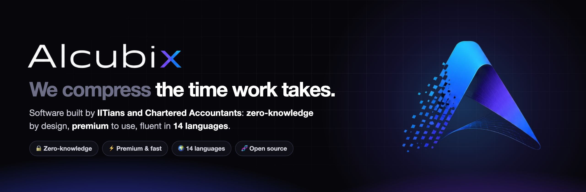
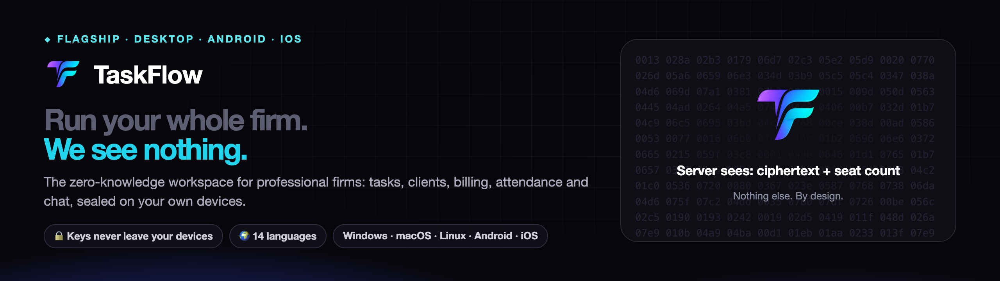

  

  
  
  
  

### 👋 We're AlcubiX

**Alcubi(erre) + (Matri)X.** Named after the Alcubierre warp drive, which contracts space in front of a ship and expands it behind.
We build software that does the same to a working day: **the busywork ahead of you shrinks, and the room to think behind you grows.**

A collective of **IITians and Chartered Accountants**, building the tools our own firms run on. Three rules, no exceptions:

| | |
|---|---|
| 🔒 **Zero-knowledge by design** | Our servers hold ciphertext and a seat count, nothing else. We built it so looking is useless. |
| ⚡ **Premium, fast, legible** | Software you live in for eight hours a day should feel like it was built by people who cared about hour nine. |
| 🌍 **Yours in 14 languages** | Any country, any timezone, right-to-left included. |

## ◆ Flagship

**[TaskFlow](https://taskflow.alcubix.com)** is the zero-knowledge workspace for professional firms: tasks, clients, billing, attendance and chat,
sealed with keys that never leave your devices. One license on Windows, macOS, Linux, Android and iOS.
&nbsp;[**Explore TaskFlow →**](https://taskflow.alcubix.com) · [**Download →**](https://alcubix.com)

## ★ Open source

**[ReplyDNA](https://github.com/AlcubiX/replydna)** is an AI YouTube comment assistant. It learns a creator's voice from their own videos,
replies in every viewer's language (English, Español, हिंदी, Hinglish …), holds scam accounts and delivers a monthly report.
Draft mode by default: the creator approves everything.
&nbsp;[**Live demo →**](https://alcubix.github.io/replydna/demo/) · [**Try it in 30 seconds →**](https://github.com/AlcubiX/replydna#-quick-start)

## Toolbox

  
  
  
  
  
  
  
  

## Talk to the people who build it

No sales layer, no ticket queue: mail lands with the team that ships the product.
📫 **[hello@alcubix.com](mailto:hello@alcubix.com)** · 🌐 **[alcubix.com](https://alcubix.com)** · ⭐ Star [ReplyDNA](https://github.com/AlcubiX/replydna) if it helps you.

© 2026 ALCUBIX Private Limited · Delhi, India · We compress the time work takes.

